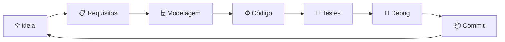

<!--
===============================================================================
  BRAYAN.DEV // GITHUB PROFILE  (v2)

  ANTES DE PUBLICAR (Ctrl + H, "Substituir tudo"):
    1. SEU_USUARIO   -> seu usuário do GitHub
    2. SEU_LINKEDIN  -> URL completa do seu LinkedIn
    3. SEU_EMAIL     -> seu e-mail profissional
    4. Confira os nomes dos repositórios na seção PROJETOS
    5. Remova esse comentário (opcional, ele não aparece no perfil)
===============================================================================
-->

 

 

## 👋 Quem sou eu

Sou **estudante do 2º e último ano de Desenvolvimento de Sistemas no SENAI**, e o que me move é entender **como as coisas funcionam por baixo**: modelar dados, escrever lógica limpa e transformar isso em aplicações que alguém realmente usa.

Minha base mais sólida é **banco de dados (MySQL/SQL)**. Em cima dela, estou construindo Back-End, Front-End e **mobile com Flutter/Dart**. Aprendo fazendo: cada conteúdo da escola vira projeto, e cada projeto vai para o GitHub com commit.

> **Filosofia:** aprender → praticar → construir → evoluir. Sem atalhos.

 

## 🎯 Foco atual

| | |
|---|---|
| 🔭 **Construindo agora** | **DevFolio App** (Flutter) e **JARVIS BR-01** (Python) |
| 📚 **Estudando** | Java, Back-End com banco de dados, Front-End (HTML/CSS) e arquitetura de software |
| 🎓 **Formação** | Técnico em Desenvolvimento de Sistemas, SENAI |
| 💼 **Procuro** | Estágio ou primeira vaga como desenvolvedor (Back-End, Mobile ou Dados) |

 

## 🚀 Projetos em destaque

<table>
<tr>
<td width="50%" valign="top">

### 📱 DevFolio App
**Flutter · Dart · Material**

Aplicativo mobile de portfólio profissional com **tela de perfil/crachá** (gradiente, avatar, chips de skills) e **dashboard de métricas** em grid com cards e selos sobrepostos.

- Widgets **reutilizáveis** em `lib/widgets/`
- Layout responsivo, sem overflow, com `ThemeData` centralizado
- Desenvolvido em dupla, com commits frequentes

`Em desenvolvimento`

[**Ver repositório →**](https://github.com/SEU_USUARIO/devfolio_app)

</td>
<td width="50%" valign="top">

### 🤖 JARVIS BR-01
**Python · Voz · Automação**

Assistente pessoal **modular** para Windows, inspirado no JARVIS: escuta voz, reconhece palavra de ativação, executa ações no computador e mantém memória.

- Arquitetura em módulos independentes: `core`, `voice`, `vision`, `system`, `interface`
- Foco em **código limpo, documentado e seguro**
- Visão computacional e análise de tela no roadmap

`Em desenvolvimento`

[**Ver repositório →**](https://github.com/SEU_USUARIO/JARVIS_BR01)

</td>
</tr>
<tr>
<td width="50%" valign="top">

### ⚽ Simulador da Fase de Grupos: Copa 2026
**Dart puro · CLI · Git**

Simulador via terminal de um grupo da Copa 2026: registro de resultados, leitura de placar via `stdin` e **classificação com os critérios oficiais de desempate** (saldo de gols, gols pró, confronto direto, fair play, ranking FIFA).

- Modelagem com classes e `enum`
- Ordenação customizada com `.sort()`
- Carregamento assíncrono e tratamento de erros com `try/catch`

`Concluído`

[**Ver repositório →**](https://github.com/SEU_USUARIO/simulador-copa-2026)

</td>
<td width="50%" valign="top">

### 🗄️ Database Lab · MySQL
**MySQL · SQL · Modelagem**

Modelagem relacional, criação de tabelas, relacionamentos, consultas e operações **CRUD**. É a minha área mais forte e a base de tudo que construo no Back-End.

- Modelo entidade-relacionamento
- Consultas com `JOIN`, filtros e agregações
- Integração com aplicações

`Ativo`

[**Ver repositório →**](https://github.com/SEU_USUARIO?tab=repositories)

</td>
</tr>
</table>

 

## 🧰 Stack

| Categoria | Tecnologias |
|:--|:--|
| **Banco de dados** |   |
| **Linguagens** |    |
| **Mobile** |  |
| **Web** |   |
| **Ferramentas** |      |
| **Ambientes** |    |

 

## 🧠 Como eu trabalho

- **Código limpo e legível.** Nomes claros, funções pequenas, comentários onde fazem diferença.
- **Modular por padrão.** Cada parte do sistema com uma responsabilidade.
- **Commits frequentes e descritivos.** O histórico conta a história do projeto.
- **Teste antes de subir.** Valido localmente antes de publicar.
- **Segurança e qualidade** desde o começo, não como remendo no final.

 

## 🎓 Formação técnica (SENAI)

<b>Ver os módulos que já trabalhei</b>

 

| Área | Módulo | O que trabalhei |
|:--|:--|:--|
| **Fundamentos** | Lógica e Algoritmos | Variáveis, condições, repetições e raciocínio computacional |
| | Sistemas Operacionais | Terminal, ambientes e fundamentos de infraestrutura |
| | Redes e IoT | Comunicação entre dispositivos e integração de hardware |
| | Levantamento de Requisitos | Análise e organização de requisitos de sistemas |
| **Dados** | Banco de Dados | MySQL, modelagem, relacionamentos, consultas e CRUD |
| **Back-End** | Back-End I e II | Lógica de aplicações, integração com dados, serviços e APIs |
| **Front-End** | Desenvolvimento Front-End | Estrutura de interfaces com HTML e CSS |
| **Engenharia** | Projetos de Software I e II | Planejamento, documentação e construção de projetos |
| | Testes de Software | Detecção de falhas, validação e qualidade |
| **Mobile** | Programação para Dispositivos Móveis | Dart e Flutter: widgets, layout, navegação e persistência |

 

## 📊 GitHub em números

 

 

 

## 🗺️ Roadmap

| Status | Meta |
|:-:|:--|
| ✅ | Lógica de programação, banco de dados, MySQL/SQL, Git e GitHub |
| 🔄 | Java, HTML, CSS, Flutter/Dart, Back-End e Front-End |
| 🔄 | Concluir o **DevFolio App** e evoluir o **JARVIS BR-01** |
| ⏳ | Aplicações completas integradas a banco de dados |
| ⏳ | Aprofundar arquitetura de software e testes automatizados |
| 🎯 | **Primeira oportunidade profissional como desenvolvedor** |

 

## 🤝 Vamos conversar?

Estou em busca de uma oportunidade para **aprender com um time de verdade e entregar valor desde o primeiro dia**. Se você tem uma vaga de estágio ou desenvolvedor júnior, ou só quer trocar uma ideia sobre tecnologia, me chama.

  

