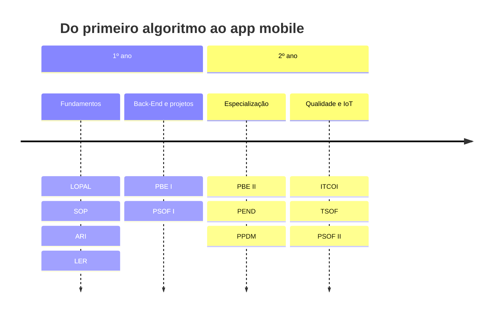
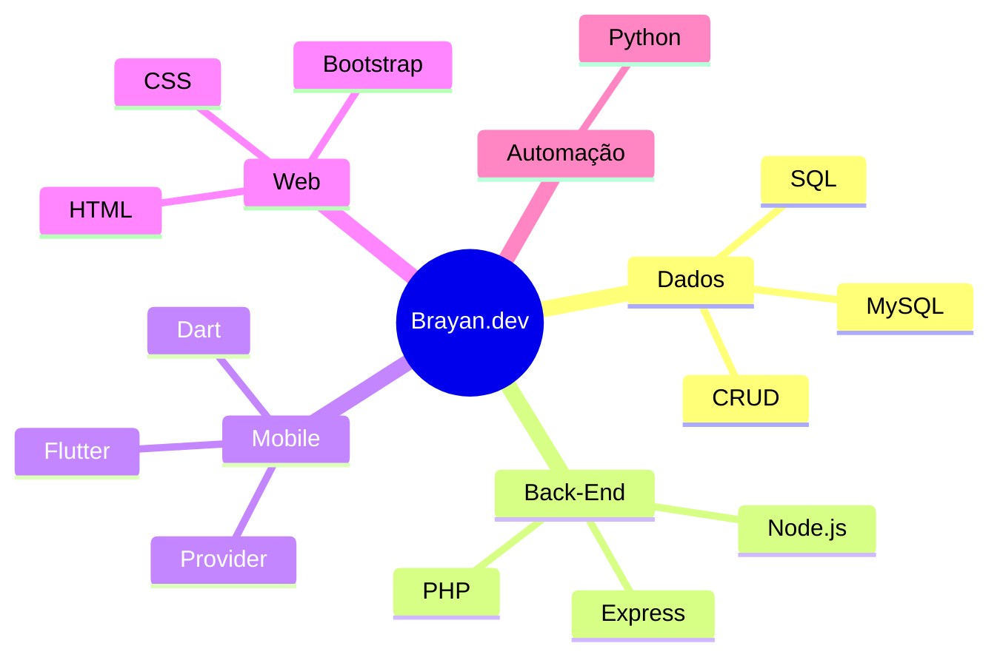
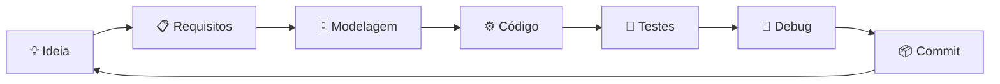

<!--
===============================================================================
  BRAYAN.DEV // GITHUB PROFILE  (v6)

  ESTE README USA 3 ARQUIVOS EXTRAS (veja o guia na conversa):
    .github/workflows/snake.yml
    .github/workflows/update-readme.yml
    scripts/update_readme.py

  ANTES DE PUBLICAR:
    1. Publique os repositórios do DevFolio, JARVIS e Simulador da Copa e
       troque os "EM BREVE" pelos links.
    2. Na seção CONTATO, descomente LinkedIn e e-mail quando quiser
       deixá-los públicos (e troque SEU_LINKEDIN e SEU_EMAIL).
    3. Rode os workflows uma vez: Actions -> Run workflow.
===============================================================================
-->

<div align="center">


<br>

<a href="https://github.com/Br4yaan"></a>


<br><br>

<a href="#sobre"></a>
<a href="#projetos"></a>
<a href="#construcao"></a>
<a href="#materias"></a>
<a href="#stack"></a>
<a href="#atividade"></a>
<a href="#contato"></a>

</div>

---

<a id="sobre"></a>

## 👋 Sobre mim

Sou **estudante do 2º e último ano do curso técnico em Desenvolvimento de Sistemas no SENAI**. O que me move é entender **como as coisas funcionam por baixo**: modelar dados, escrever lógica limpa e transformar isso em aplicações que alguém realmente usa.

Minha base mais forte é **banco de dados**. Em cima dela construo Back-End, Front-End e **mobile com Flutter/Dart**. Cada conteúdo da escola vira projeto, e cada projeto vai para o GitHub com commit. Neste perfil eu deixo claro o que está concluído, o que está em construção e o que foi só estudo.

```dart
// whoami.dart
class Dev {
  final String nome = 'Brayan Albuquerque';
  final String formacao = 'Técnico em Desenvolvimento de Sistemas · SENAI';
  final String etapa = '2º e último ano';

  final List<String> stack = [
    'MySQL', 'PHP', 'Dart', 'Flutter', 'Node.js', 'Python',
  ];
  final List<String> estudando = ['Java', 'Arquitetura de software', 'Testes'];

  bool get abertoAOportunidades => true;
  String get lema => 'Aprender → Praticar → Construir → Evoluir';
}

void main() {
  final brayan = Dev();
  print('${brayan.nome} | aberto a oportunidades: ${brayan.abertoAOportunidades}');
}
```

<br>

## 🎯 Foco atual

| | |
|---|---|
| 🔭 **Construindo agora** | **DevFolio App** (Flutter, projeto final de PPDM) e **JARVIS BR-01** (assistente pessoal em Python) |
| 📚 **Estudando** | Java, Back-End com banco de dados, Front-End, testes e arquitetura de software |
| 🎓 **Formação** | Técnico em Desenvolvimento de Sistemas, SENAI |
| 💼 **Procuro** | Estágio ou primeira vaga como desenvolvedor (Back-End, Mobile ou Dados) |

<br>

<a id="projetos"></a>

## 🚀 Projetos em destaque

> Repositórios publicados, com código para você explorar.

<table>
  <tr>
    <td width="50%" valign="top">
      <h3>🍕 Pizzaria DB</h3>
      <p><strong>PHP · MySQL · HTML</strong> &nbsp; </p>
      <p>Projeto acadêmico de gerenciamento de clientes, com conexão entre PHP e MySQL.</p>
      <ul>
        <li>Cadastro, listagem e edição de registros.</li>
        <li>Operações de CRUD e integração com o banco usando <code>mysqli</code>.</li>
      </ul>
      <a href="https://github.com/Br4yaan/pizzaria.db"><strong>Explorar repositório →</strong></a>
    </td>
    <td width="50%" valign="top">
      <h3>🛒 Provider + ChangeNotifier</h3>
      <p><strong>Flutter · Dart · Provider</strong> &nbsp; </p>
      <p>Catálogo de produtos conectado a um carrinho, para praticar gerenciamento de estado e atualização reativa da interface.</p>
      <ul>
        <li>Adicionar e remover produtos.</li>
        <li>Quantidade e total atualizados em tempo real; finalização simulada.</li>
      </ul>
      <a href="https://github.com/Br4yaan/012-Atividade-Aula-12-Provider-ChangeNotifier"><strong>Explorar repositório →</strong></a>
    </td>
  </tr>
  <tr>
    <td width="50%" valign="top">
      <h3>🧭 Navegação App</h3>
      <p><strong>Flutter · Dart</strong> &nbsp; </p>
      <p>Lista de produtos e uma tela de detalhes que recebe dados e devolve um resultado à tela anterior.</p>
      <ul>
        <li><code>Navigator.push()</code>, <code>Navigator.pop()</code> e <code>MaterialPageRoute</code>.</li>
        <li>Passagem de dados entre telas por construtor.</li>
      </ul>
      <a href="https://github.com/Br4yaan/navegacao_app"><strong>Explorar repositório →</strong></a>
    </td>
    <td width="50%" valign="top">
      <h3>⌨️ Dartpedia</h3>
      <p><strong>Dart · CLI</strong> &nbsp; </p>
      <p>Aplicação de linha de comando em Dart puro, com diretórios separados para execução, biblioteca e testes.</p>
      <ul>
        <li>Organização em <code>bin/</code>, <code>lib/</code> e testes.</li>
        <li>Pacote interno <code>command_runner</code> para comandos e argumentos.</li>
      </ul>
      <a href="https://github.com/Br4yaan/dartpedia"><strong>Explorar repositório →</strong></a>
    </td>
  </tr>
</table>

<br>

<a id="construcao"></a>

## 🛠️ Em construção

<table>
  <tr>
    <td width="33%" valign="top">
      <h3>📱 DevFolio App</h3>
      <p><strong>Flutter · Dart · Material 3</strong></p>
      
      <p>Projeto final de PPDM: app de portfólio com telas de <strong>Perfil</strong> e <strong>Dashboard</strong>, componentes reutilizáveis e layout adaptável à largura da tela.</p>
      <p><sub><code>LayoutBuilder</code> · <code>GridView</code> · <code>Wrap</code> · <code>Stack</code> · <code>Card</code> · <code>AnimatedSwitcher</code></sub></p>
      <p><strong>Repositório:</strong> EM BREVE</p>
    </td>
    <td width="33%" valign="top">
      <h3>🤖 JARVIS BR-01</h3>
      <p><strong>Python · Windows</strong></p>
      
      <p>Assistente pessoal <strong>modular</strong>, inspirado em assistentes de ficção científica. Direção: comandos por voz, palavra de ativação, automação do computador e memória.</p>
      <p><sub>Visão computacional e análise de tela são objetivos <strong>futuros</strong>, ainda não implementados.</sub></p>
      <p><strong>Repositório:</strong> EM BREVE</p>
    </td>
    <td width="33%" valign="top">
      <h3>⚽ Simulador Copa 2026</h3>
      <p><strong>Dart puro · CLI · PPDM</strong></p>
      
      <p>Simulador de um grupo da Copa pelo terminal: registra resultados e monta a classificação aplicando os critérios de desempate.</p>
      <p><sub>Classes · <code>enum</code> · <code>.sort()</code> · async · <code>try/catch</code></sub></p>
      <p><strong>Repositório:</strong> EM BREVE</p>
    </td>
  </tr>
</table>

<details>
<summary><b>💡 Como funciona o desempate (exemplo ilustrativo e simplificado)</b></summary>

<br>

A ideia central do simulador é ordenar o grupo aplicando os critérios em cascata. Este trecho é só uma ilustração do conceito, não o código do projeto:

```dart
class Selecao {
  Selecao(this.nome);

  final String nome;
  int pontos = 0;
  int golsPro = 0;
  int golsContra = 0;

  int get saldo => golsPro - golsContra;
}

/// Ordena o grupo: pontos, depois saldo de gols, depois gols pró.
void classificar(List<Selecao> grupo) {
  grupo.sort((a, b) {
    final porPontos = b.pontos.compareTo(a.pontos);
    if (porPontos != 0) return porPontos;

    final porSaldo = b.saldo.compareTo(a.saldo);
    if (porSaldo != 0) return porSaldo;

    return b.golsPro.compareTo(a.golsPro);
  });
}
```

Cada critério só entra em ação quando o anterior empata. No projeto, a cascata continua com confronto direto, fair play e ranking FIFA.

</details>

<br>

<a id="materias"></a>

## 📚 Projetos por matéria

<details open>
<summary><b>🗄️ Banco de Dados e Back-End</b></summary>

<br>

**[Pizzaria DB](https://github.com/Br4yaan/pizzaria.db)** · `PHP` `MySQL` · Concluído
Cadastro, listagem e edição de clientes com CRUD, conectando PHP ao MySQL.

**MPDWorks: Sua Casa Sempre** · `Node.js` `Express` `MySQL` `HTML` `CSS` · Em andamento
Sistema acadêmico de serviços de manutenção residencial, com Back-End, modelagem de dados e interface web baseada em uma proposta visual do Figma. A arquitetura evoluiu ao longo do desenvolvimento: a configuração inicial usava Node.js, Express, MongoDB e JWT, e a modelagem passou depois para scripts SQL no MySQL.

</details>

<details open>
<summary><b>📱 Mobile · PPDM (Flutter / Dart)</b></summary>

<br>

| Repositório | O que pratiquei |
|:--|:--|
| [**cep_app**](https://github.com/Br4yaan/cep_app) | Aplicação de estudo voltada à consulta de CEP |
| [**birdle**](https://github.com/Br4yaan/birdle) | Jogo de palavras inspirado no Wordle |
| [**cracha_app**](https://github.com/Br4yaan/cracha_app) · [**prova_cracha_app**](https://github.com/Br4yaan/prova_cracha_app) | Tela de crachá/perfil (atividade e prova prática) |
| [**layout_app**](https://github.com/Br4yaan/layout_app) · [**atividade_layout**](https://github.com/Br4yaan/atividade_layout) · [**prova_layout_app**](https://github.com/Br4yaan/prova_layout_app) | Organização visual e layout com widgets (estudo, atividade e prova prática) |
| [**ppdm-layout-widgets**](https://github.com/Br4yaan/ppdm-layout-widgets) | Composição e posicionamento com `Row`, `Column`, `Stack` e outros |
| [**Atividade_ppdm**](https://github.com/Br4yaan/Atividade_ppdm) | Atividades da matéria |

</details>

<details>
<summary><b>🌐 Front-End · PEND</b></summary>

<br>

Atividade de Front-End com **Bootstrap**, além da interface web do MPDWorks (HTML e CSS).

</details>

<details>
<summary><b>🧪 Testes de Software · TSOF</b></summary>

<br>

**Trabalho acadêmico em ABNT: "A Importância dos Testes de Software"**

Análise de dois casos reais de falha de qualidade: a **falha após a migração da infraestrutura do TSB Bank (2018)** e o caso da **Volkswagen**, cujo software identificava condições de teste de emissões. Discute os impactos e como verificação, validação, testes de integração, segurança, desempenho e conformidade reduziriam os riscos.

É um trabalho teórico, não um framework de testes automatizados.

</details>

<details>
<summary><b>🧰 Versionamento · Git</b></summary>

<br>

**[AulaGitT3](https://github.com/Br4yaan/AulaGitT3)**: primeiros passos com Git e GitHub.

</details>

<details>
<summary><b>🧱 Fundamentos e Projetos de Software</b></summary>

<br>

LOPAL, SOP, ARI, LER, PSOF I e II e ITCOI formaram a base de lógica, sistemas operacionais, redes, requisitos, planejamento de projetos e IoT que sustenta tudo acima.

</details>

<br>

## 🗺️ Jornada no SENAI



<details>
<summary><b>Ver o que estudei em cada matéria</b></summary>

<br>

| Matéria | Conteúdo |
|:--|:--|
| **LOPAL** · Lógica e Algoritmos | Variáveis, condições, repetições e raciocínio computacional |
| **SOP** · Sistemas Operacionais | Terminal, ambientes e fundamentos de infraestrutura |
| **ARI** · Redes | Comunicação entre dispositivos e fundamentos de redes |
| **LER** · Levantamento de Requisitos | Análise e organização de requisitos de sistemas |
| **BCD** · Banco de Dados | MySQL, modelagem, relacionamentos, consultas e CRUD |
| **PBE I e II** · Back-End | Lógica de aplicações, integração com dados, serviços e APIs |
| **PEND** · Front-End | Estrutura de interfaces com HTML, CSS e Bootstrap |
| **PSOF I e II** · Projetos de Software | Planejamento, documentação e construção de projetos |
| **TSOF** · Testes de Software | Qualidade, verificação, validação e tipos de testes |
| **ITCOI** · Internet das Coisas | Conceitos de IoT e integração de dispositivos |
| **PPDM** · Desenvolvimento Mobile | Dart e Flutter: widgets, layout, navegação e estado com Provider |

</details>

<br>

<a id="stack"></a>

## 🧰 Stack

<div align="center">


<sub>Também estudando: **Java**, **Docker**, arquitetura de software e testes.</sub>

</div>



<br>

<a id="atividade"></a>

## 📡 Atividade ao vivo

Esta seção **se atualiza sozinha** com uma GitHub Action que roda todo dia e consulta a API do GitHub.

<!-- SUMMARY:START -->
📦 **15** repositórios próprios · ⏱️ última atividade em **—**
<!-- SUMMARY:END -->

**Últimos repositórios mexidos:**

<!-- RECENT:START -->
| Repositório | Descrição | Última atividade |
|:--|:--|:-:|
| [**pizzaria.db**](https://github.com/Br4yaan/pizzaria.db) | — | — |
| [**navegacao_app**](https://github.com/Br4yaan/navegacao_app) | — | — |
| [**dartpedia**](https://github.com/Br4yaan/dartpedia) | — | — |
<!-- RECENT:END -->

<div align="center">

<picture>
  <source media="(prefers-color-scheme: dark)" srcset="https://raw.githubusercontent.com/Br4yaan/Br4yaan/output/github-snake-dark.svg" />
  <source media="(prefers-color-scheme: light)" srcset="https://raw.githubusercontent.com/Br4yaan/Br4yaan/output/github-snake.svg" />
  
</picture>

<br>

<a href="https://github.com/Br4yaan">
  <picture>
    <source media="(prefers-color-scheme: dark)" srcset="https://github-readme-stats.vercel.app/api?username=Br4yaan&show_icons=true&hide_border=true&rank_icon=github&theme=tokyonight&locale=pt-br" />
    
  </picture>
</a>
<a href="https://github.com/Br4yaan">
  <picture>
    <source media="(prefers-color-scheme: dark)" srcset="https://github-readme-stats.vercel.app/api/top-langs/?username=Br4yaan&layout=compact&langs_count=6&hide=c%2B%2B,cmake,c&hide_border=true&theme=tokyonight&locale=pt-br" />
    
  </picture>
</a>

<br>


<br>


<sub>As estatísticas vêm de serviços externos e podem ficar indisponíveis por alguns instantes. Linguagens geradas automaticamente pelo Flutter (C++/CMake) ficam de fora do gráfico. A distribuição de linguagens reflete o conteúdo dos repositórios, não o nível de domínio.</sub>

</div>

<br>

## 🧠 Como eu trabalho



- **Código limpo e legível.** Nomes claros, funções pequenas, comentários onde fazem diferença.
- **Modular por padrão.** Cada parte do sistema com uma responsabilidade.
- **Commits frequentes e descritivos.** O histórico conta a história do projeto.
- **Teste antes de subir.** Valido localmente antes de publicar.

<br>

## 🎯 Roadmap

| Status | Meta |
|:-:|:--|
| ✅ | Lógica de programação, banco de dados, MySQL/SQL, Git e GitHub |
| ✅ | Flutter: layout, navegação e gerenciamento de estado com Provider |
| 🔄 | Concluir o **DevFolio App** e evoluir o **JARVIS BR-01** |
| 🔄 | Java, Back-End e Front-End |
| ⏳ | Aplicações completas integradas a banco de dados |
| ⏳ | Aprofundar arquitetura de software e testes automatizados |
| 🎯 | **Primeira oportunidade profissional como desenvolvedor** |

<br>

<a id="contato"></a>

## 🤝 Vamos conversar?

Estou em busca de uma oportunidade para **aprender com um time de verdade e entregar valor desde o primeiro dia**.

```sql
SELECT *
  FROM desenvolvedores
 WHERE nome = 'Brayan Albuquerque'
   AND disponibilidade = 'estágio / júnior'
   AND vontade_de_aprender = 'MAX'
 LIMIT 1;

-- 1 row in set (0.00 sec)
```

<div align="center">

<a href="https://github.com/Br4yaan"></a>

<!--
  DESCOMENTE QUANDO QUISER DEIXAR PÚBLICO (e troque SEU_LINKEDIN / SEU_EMAIL):

<a href="SEU_LINKEDIN"></a>
<a href="mailto:SEU_EMAIL"></a>
-->

</div>

<details>
<summary><sub>🥚 easter egg</sub></summary>

```dart
// aura.dart
int aura = 0;

void commit() => aura += 100; // um commit de cada vez

void main() {
  for (var i = 0; i < 10; i++) {
    commit();
  }
  print('aura: $aura'); // aura: 1000
}
```

</details>

<br>

<div align="center">


</div>
