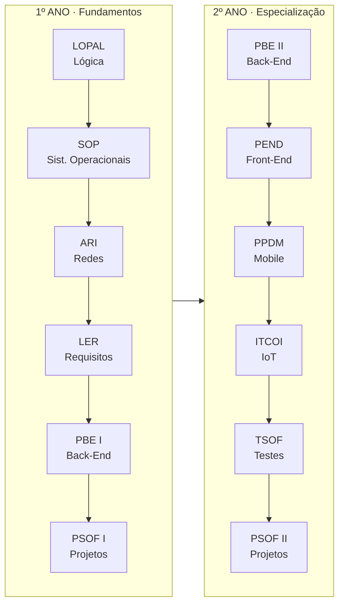

<!--
===============================================================================
  BRAYAN.DEV // GITHUB PROFILE  (v5)

  ANTES DE PUBLICAR (Ctrl + H, "Substituir tudo"):
    1. SEU_LINKEDIN  -> URL completa do seu LinkedIn
    2. SEU_EMAIL     -> seu e-mail profissional
    3. Quando o DevFolio App, o Simulador da Copa e o JARVIS BR-01 estiverem
       no GitHub, procure por "EM BREVE" e troque pelo link do repositório
===============================================================================
-->

 

  

 

## 👋 Quem sou eu

Sou **estudante do 2º e último ano de Desenvolvimento de Sistemas no SENAI**, e o que me move é entender **como as coisas funcionam por baixo**: modelar dados, escrever lógica limpa e transformar isso em aplicações que alguém realmente usa.

Minha base mais forte é **banco de dados**. Em cima dela construo Back-End, Front-End e **mobile com Flutter/Dart**. Aprendo fazendo: cada conteúdo da escola vira projeto, e cada projeto vai para o GitHub com commit.

> **Filosofia:** aprender → praticar → construir → evoluir. Sem atalhos.

 

## 🎯 Foco atual

| | |
|---|---|
| 🔭 **Construindo agora** | **DevFolio App** (Flutter, projeto final de PPDM) e **JARVIS BR-01** (assistente pessoal em Python) |
| 📚 **Estudando** | Java, Back-End com banco de dados, Front-End e arquitetura de software |
| 🎓 **Formação** | Técnico em Desenvolvimento de Sistemas, SENAI |
| 💼 **Procuro** | Estágio ou primeira vaga como desenvolvedor (Back-End, Mobile ou Dados) |

 

## 🚀 Projetos em destaque

<table>
<tr>
<td width="50%" valign="top">

### 🍕 Pizzaria DB
**Banco de Dados / Back-End · Concluído**

Cadastro e gerenciamento de clientes, desenvolvido nas aulas do SENAI com **PHP e MySQL**.

- Conexão entre PHP e MySQL com `mysqli`
- Cadastro, listagem e edição de registros
- Modelagem de dados e operações **CRUD**

`PHP` `MySQL` `HTML`

[**Ver repositório →**](https://github.com/Br4yaan/pizzaria.db)

</td>
<td width="50%" valign="top">

### ⚽ Simulador da Fase de Grupos: Copa 2026
**PPDM · Dart puro · CLI · Concluído**

Simulador via terminal de um grupo da Copa: registro de resultados e **classificação com os critérios oficiais de desempate** (saldo de gols, gols pró, confronto direto, fair play e ranking FIFA).

- Modelagem com classes e `enum`
- Ordenação customizada com `.sort()`
- Carregamento assíncrono e tratamento de erros (`try/catch`)

`Dart` · Repositório: **EM BREVE**

</td>
</tr>
<tr>
<td colspan="2" valign="top">

### 📱 DevFolio App
**PPDM · Flutter / Dart · Em desenvolvimento**

Aplicativo mobile de portfólio profissional, projeto final da matéria. Duas telas principais, **Perfil** e **Dashboard** de métricas e projetos, construídas com componentes reutilizáveis.

- Tema visual centralizado com **Material Design 3**
- Layout responsivo com `LayoutBuilder`: navegação lateral em telas largas e inferior em telas menores
- `GridView`, `Wrap`, `Stack`, `Positioned`, `Card` e `AnimatedSwitcher`
- Cuidado com overflow em textos e áreas roláveis

`Flutter` `Dart` `Material 3` · Repositório: **EM BREVE**

</td>
</tr>
</table>

 

## 📚 Projetos por matéria

<b>🗄️ Banco de Dados e Back-End</b>

 

**[Pizzaria DB](https://github.com/Br4yaan/pizzaria.db)** · `PHP` `MySQL` · Concluído
Cadastro, listagem e edição de clientes com CRUD, conectando PHP ao MySQL.

**MPDWorks: Sua Casa Sempre** · `Node.js` `Express` `MySQL` `HTML` `CSS` · Em andamento
Sistema de serviços de manutenção residencial com Back-End, banco de dados e interface web. O Back-End começou com Node.js, Express, MongoDB e JWT, e a modelagem de dados migrou depois para scripts SQL no MySQL (incluindo tabelas de estoque de materiais, categorias de produto e fornecedores). A interface foi desenvolvida em HTML e CSS, seguindo uma proposta visual feita no Figma.

<b>📱 Mobile · PPDM (Flutter / Dart)</b>

 

**Estado e navegação**

- **[Provider + ChangeNotifier](https://github.com/Br4yaan/012-Atividade-Aula-12-Provider-ChangeNotifier)**: catálogo de produtos conectado a um carrinho. Adiciona e remove itens, atualiza quantidade e valor total em tempo real. Conceitos: `ChangeNotifier`, `ChangeNotifierProvider`, `Consumer` e separação entre modelo e estado.
- **[navegacao_app](https://github.com/Br4yaan/navegacao_app)**: lista de produtos e tela de detalhes. Conceitos: `Navigator.push()`, `Navigator.pop()`, `MaterialPageRoute`, passagem de dados por construtor e retorno de resultado para a tela anterior.

**Dart puro**

- **[dartpedia](https://github.com/Br4yaan/dartpedia)**: aplicação de linha de comando organizada em `bin/`, `lib/` e testes, com um pacote interno `command_runner` para comandos e argumentos.

**Interface e layout**

| Repositório | Tema |
|:--|:--|
| [**cep_app**](https://github.com/Br4yaan/cep_app) | Consulta de CEP |
| [**birdle**](https://github.com/Br4yaan/birdle) | Jogo de palavras inspirado no Wordle |
| [**cracha_app**](https://github.com/Br4yaan/cracha_app) · [**prova_cracha_app**](https://github.com/Br4yaan/prova_cracha_app) | Tela de crachá/perfil (atividade e prova prática) |
| [**layout_app**](https://github.com/Br4yaan/layout_app) · [**atividade_layout**](https://github.com/Br4yaan/atividade_layout) · [**prova_layout_app**](https://github.com/Br4yaan/prova_layout_app) | Layout com widgets (estudo, atividade e prova prática) |
| [**ppdm-layout-widgets**](https://github.com/Br4yaan/ppdm-layout-widgets) | Widgets de layout (`Row`, `Column`, `Stack` e outros) |
| [**Atividade_ppdm**](https://github.com/Br4yaan/Atividade_ppdm) | Atividades da matéria |

<b>🌐 Front-End · PEND</b>

 

Atividade de Front-End com **Bootstrap**, além da interface web do MPDWorks (HTML e CSS).

<b>🧪 Testes de Software · TSOF</b>

 

**Trabalho acadêmico em ABNT: "A Importância dos Testes de Software"**

Análise de dois casos reais de falha de qualidade: a **falha após a migração da infraestrutura do TSB Bank (2018)** e o caso da **Volkswagen**, cujo software identificava condições de teste de emissões. O trabalho discute os impactos e como testes e verificações adequados reduziriam os riscos.

Conceitos: qualidade, verificação e validação, testes de integração, segurança, desempenho e conformidade.

<b>🧰 Versionamento · Git</b>

 

**[AulaGitT3](https://github.com/Br4yaan/AulaGitT3)**: primeiros passos com Git.

<b>🧱 Fundamentos e Projetos de Software</b>

 

LOPAL, SOP, ARI, LER, PSOF I e II e ITCOI formaram a base de lógica, sistemas operacionais, redes, requisitos, planejamento de projetos e IoT que sustenta os projetos acima. Veja os conteúdos na [jornada abaixo](#-jornada-no-senai).

 

## 🤖 Projeto pessoal

### JARVIS BR-01
**Python · Em desenvolvimento · Repositório: EM BREVE**

Assistente pessoal **modular** para Windows, inspirado no JARVIS do Homem de Ferro.

- **Escopo:** voz, palavra de ativação, automação do computador e memória, organizados em módulos independentes (`core`, `voice`, `vision`, `system`, `interface`)
- **Princípios:** código limpo, documentado e seguro, com separação de responsabilidades
- **Planejado para o futuro:** visão computacional e análise de tela

 

## 🧰 Stack

| Categoria | Tecnologias |
|:--|:--|
| **Banco de dados** |   |
| **Back-End** |    |
| **Mobile** |   |
| **Web** |    |
| **Automação** |  |
| **Ferramentas** |      |
| **Em estudo** |   |

 

## 🎓 Jornada no SENAI

<b>Ver o que estudei em cada matéria</b>

 

| Matéria | Conteúdo |
|:--|:--|
| **LOPAL** · Lógica e Algoritmos | Variáveis, condições, repetições e raciocínio computacional |
| **SOP** · Sistemas Operacionais | Terminal, ambientes e fundamentos de infraestrutura |
| **ARI** · Redes | Comunicação entre dispositivos e fundamentos de redes |
| **LER** · Levantamento de Requisitos | Análise e organização de requisitos de sistemas |
| **BCD** · Banco de Dados | MySQL, modelagem, relacionamentos, consultas e CRUD |
| **PBE I e II** · Back-End | Lógica de aplicações, integração com dados, serviços e APIs |
| **PEND** · Front-End | Estrutura de interfaces com HTML e CSS |
| **PSOF I e II** · Projetos de Software | Planejamento, documentação e construção de projetos |
| **TSOF** · Testes de Software | Qualidade, verificação, validação e tipos de testes |
| **ITCOI** · Internet das Coisas | Conceitos de IoT e integração de dispositivos |
| **PPDM** · Desenvolvimento Mobile | Dart e Flutter: widgets, layout, navegação e estado com Provider |

 

## 🧠 Como eu trabalho

- **Código limpo e legível.** Nomes claros, funções pequenas, comentários onde fazem diferença.
- **Modular por padrão.** Cada parte do sistema com uma responsabilidade.
- **Commits frequentes e descritivos.** O histórico conta a história do projeto.
- **Teste antes de subir.** Valido localmente antes de publicar.

 

## 📊 GitHub em números

 

 

 

## 🗺️ Roadmap

| Status | Meta |
|:-:|:--|
| ✅ | Lógica de programação, banco de dados, MySQL/SQL, Git e GitHub |
| ✅ | Flutter: layout, navegação e gerenciamento de estado com Provider |
| 🔄 | Concluir o **DevFolio App** e evoluir o **JARVIS BR-01** |
| 🔄 | Java, Back-End e Front-End |
| ⏳ | Aplicações completas integradas a banco de dados |
| ⏳ | Aprofundar arquitetura de software e testes automatizados |
| 🎯 | **Primeira oportunidade profissional como desenvolvedor** |

 

## 🤝 Vamos conversar?

Estou em busca de uma oportunidade para **aprender com um time de verdade e entregar valor desde o primeiro dia**. Se você tem uma vaga de estágio ou desenvolvedor júnior, ou só quer trocar uma ideia sobre tecnologia, me chama.

  

